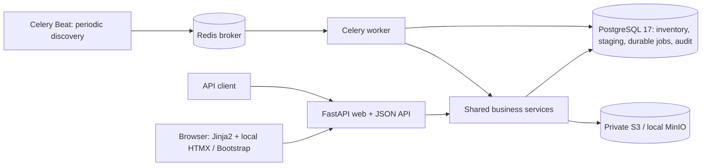
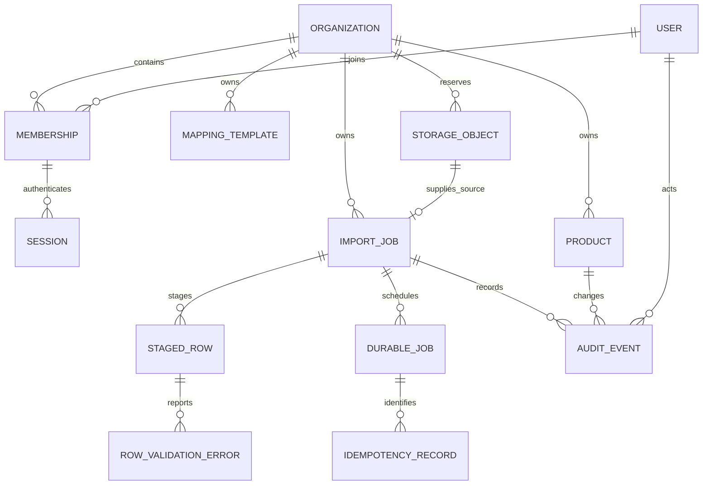
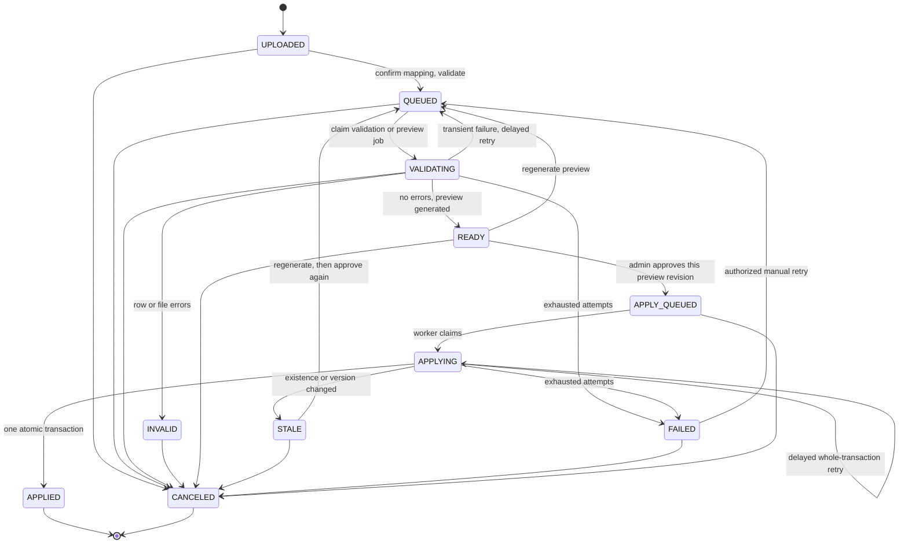

# ImportGuard

A full-stack supplier CSV importer built with Python 3.12, FastAPI, server-rendered Jinja2, HTMX, Bootstrap 5, PostgreSQL 17, Celery, Redis, and private S3 storage. Inventory changes require an administrator's explicit approval and commit atomically with their audit history.

## Run locally

Prerequisites: Docker Desktop with Linux containers and Compose v2+, plus [uv](https://docs.astral.sh/uv/) if running Python commands on the host. Ports 8000, 5439, 6389, 9009, and 9010 must be free.

PowerShell:

```powershell
Copy-Item .env.example .env
docker compose up -d --build
docker compose ps
```

macOS/Linux:

```bash
cp .env.example .env
docker compose up -d --build
docker compose ps
```

Open **http://127.0.0.1:8000/register** and create a workspace. The private storage console is at http://127.0.0.1:9010; its development credentials are in `.env.example`. Neither files nor bucket policies allow anonymous access. Compose ports are bound to loopback.

The `migrate` and `bucket-init` services must exit successfully; the web, worker, and Beat then start. The first build compiles a pinned official MinIO source release and downloads Go dependencies; allow several minutes. Official community image tags were removed from registries, so `Dockerfile.minio` avoids an unofficial replacement image. See [upstream releases](https://github.com/minio/minio/releases/tag/RELEASE.2025-10-15T17-29-55Z). All Python dependencies are exact stable pins in `pyproject.toml`, with complete transitive resolution in `uv.lock`.

```powershell
docker compose logs -f web worker beat
docker compose exec web alembic current
docker compose exec web python -m scripts.manage --help
docker compose stop
```

`docker compose stop` preserves the PostgreSQL, Redis, and object-storage volumes. Migrations also run with `docker compose run --rm migrate`. Do not delete volumes unless intentionally resetting all local data.

### Optional demo accounts

Demo credentials are disabled by default and never created at startup. This explicit development command creates two organizations and separate admin, editor, and viewer accounts:

```powershell
docker compose exec -e DEMO_SEED_ENABLED=true web python -m scripts.manage seed
```

| Organization | Admin | Editor | Viewer |
| --- | --- | --- | --- |
| North Market | admin@north.example.com | editor@north.example.com | viewer@north.example.com |
| South Supply | admin@south.example.com | editor@south.example.com | viewer@south.example.com |

The development-only password is `ImportGuard-demo-2026!`. Seeding is repeatable and skips existing demo organizations. To create a real additional member, use the printed organization UUID and an interactive password prompt:

```powershell
docker compose exec web python -m scripts.manage add-member ORGANIZATION_UUID person@example.com --role EDITOR
```

For scripted development, the command also accepts `IMPORTGUARD_MEMBER_PASSWORD` from the environment; it refuses to overwrite an existing account. Version one selects the user's oldest membership at login. Registration creates an admin and an organization together; there is no tenant ID parameter that grants access to another organization.

### Host Python development

```powershell
uv sync --frozen
docker compose up -d postgres redis minio bucket-init
uv run alembic upgrade head
uv run uvicorn app.main:app --reload --host 127.0.0.1 --port 8000
```

Use two additional terminals for the worker and scheduler. On Windows, use Celery's solo pool for development; Compose runs the normal Linux prefork pool.

```powershell
uv run celery -A app.tasks.celery_app:celery worker --pool=solo --loglevel=INFO
uv run celery -A app.tasks.celery_app:celery beat --loglevel=INFO
```

Do not run host and Compose workers against different code revisions. Stop Compose `web worker beat` before running their host equivalents. `.env.example` uses host addresses; Compose replaces them with its internal service addresses.

## Architecture and responsibilities



`app/api` and `app/web` adapt requests; `app/services` owns authorization, transactions and workflows; `app/importers` handles strict CSV and field normalization; `app/repositories` provides scoped lookups and pagination; `app/storage` isolates Boto3; `app/tasks` supplies Celery wake-ups. Each request or task owns its session. Network I/O never runs inside an inventory-lock transaction. SQLAlchemy uses synchronous sessions and Psycopg 3.

Small public response schemas live in `app/schemas/responses.py`. They prevent credentials and object keys from leaking and document JSON responses in OpenAPI. Error responses have `code`, `message`, and `request_id`. JSON prices are decimal strings. Filters validate pagination, status, search length and action. Interactive API docs are at `/docs`; GET `/openapi.json` provides the specification. Cookie authentication and CSRF are required for state-changing API calls too.

### Relationships



Tenant-aware composite foreign keys connect imports, uploaders, approval actors, staged rows, errors, products, audit events, source reservations, and idempotency jobs. Unique `(organization_id, sku)` and `(import_id, record_number)` constraints enforce business identities. A partial unique index permits only one pending/running durable job per import.

## Import semantics and limits

Defaults are configurable in `.env.example`: **10 MiB**, **50,000 data records**, **50 columns**, **500 records per batch**. Only UTF-8 (with optional BOM), comma separation and one nonblank, unique header row are supported. Header uniqueness includes trimmed, case-folded comparisons. No delimiter or encoding guessing is performed. Samples are bounded to five records. The request body is bounded as it streams, including chunked transfer, with 64 KiB reserved for multipart framing; the file itself has the exact configured byte limit.

| Field | Rules |
| --- | --- |
| SKU | Trim; uppercase ASCII letters; 1–64 characters from `A-Z`, `0-9`, `-`, `_`, `.` |
| Name | Trim; 1–200 characters |
| Category | Optional; trim; at most 100 characters |
| Unit price | Unsigned plain decimal; 0 through 9,999,999,999.99; at most two decimal places |
| Stock quantity | Unsigned whole number; 0 through 1,000,000,000 |

NaN, infinity, exponent notation, currency symbols, signed values, thousands separators, decimal quantities and hidden NUL characters in text are rejected. Prices use `Decimal` and PostgreSQL `NUMERIC(12,2)`; no float arithmetic, rounding or truncation is used.

New SKUs create products. Existing SKUs update mapped fields. Quantities are **absolute replacements**. Missing products remain; imports never delete. An unmapped category preserves an existing category; a mapped empty category clears it. Every changed product increments its version. An unchanged import row does not produce an inventory write. Manual saves increment the product version even if the submitted values are identical.

All occurrences of a duplicate normalized SKU are invalid, including duplicates separated by batches or worker restarts. Any invalid record blocks the whole import. Correct the source and upload a new file; there is no inline row editing, automatic duplicate merging, or partial application. File-level parse errors also block application and appear on the import page.

Suggestions use only the alias dictionary in `csv_importer.py`. Users must confirm them; source columns cannot map to multiple destination fields. Mapping freezes when validation is queued. Named templates belong to one organization and are checked against each new file before use.

## States, recovery, and concurrency



`failure_stage` remains separate from status. After a terminal apply failure, manual retry regenerates the preview and requires fresh approval. Invalid source data cannot be retried into validity. Once an apply attempt starts, cancellation returns 409, including during its automatic retry wait. Cancellation before that point invalidates pending/running job ownership and stops validation at its next batch boundary.

**Durable work:** queuing changes both import state and the PostgreSQL job table in one transaction. Beat periodically discovers pending work and expired leases, then sends Celery wake-ups. Duplicate messages are expected. Redis loss cannot erase the database job; recovery resumes when the broker returns. A worker claims a job under row locks and increments a fencing number. Every write transaction checks the number, active state and lease expiry under the same locks. An expired owner cannot commit a new batch after another owner claims it. A transaction already holding these locks finishes before another claim can take ownership; the lease is a recovery boundary, not permission to interrupt an in-progress PostgreSQL commit.

**Validation recovery:** each batch and its checkpoint commit together. On restart, the CSV parser begins again and skips already committed logical records. This costs O(checkpoint) re-reading and preserves quoted multiline records correctly. No byte offsets are used. A rollback repeats the uncommitted batch. A final database-wide duplicate pass marks every occurrence, followed by preview generation. Validation never modifies inventory.

**Application:** preview generation, manual product saves and apply transactions all lock the organization's PostgreSQL row using `SELECT ... FOR UPDATE`. The row acts as the organization inventory mutex; writes for different organizations can proceed independently. Previews save expected versions, absence assumptions, old values and proposed actions. The apply worker takes the same mutex and checks **every relevant SKU**, including unchanged rows. A mismatch commits `STALE` without inventory changes. Approval is tied to a random preview revision, so a confirmation screen from an earlier generation cannot approve the current one.

When assumptions hold, all product changes, version increments, change audit entries, the final summary audit entry and `APPLIED` commit in one transaction. Failures roll the transaction back. Automatic retries repeat the complete transaction. An organization-scoped `Idempotency-Key` identifies the import and preview; using it for another operation returns 409. Replays return the original job. New keys for an already queued/applied import also resolve to its existing job. This provides duplicate-safe business effects; it does **not** claim exactly-once task delivery.

Jobs retry at increasing delays (2, 4, 8, 16… seconds, capped at 300), up to `MAX_JOB_ATTEMPTS` (default 5), including expired claims. A final failure is visible with its stage and job reference. Use `python -m scripts.manage work-once` to drain currently available database jobs manually during broker maintenance; the command follows the same ownership protocol. It is not required in normal operation.

## Authentication and storage decisions

Passwords use Argon2id. Random 256-bit session tokens are sent only in HttpOnly, SameSite=Lax cookies; only SHA-256 hashes and expiry are stored in PostgreSQL. Logout deletes the session. CSRF uses a random readable cookie, matching form/header token, session-bound hash and same-origin validation. GET `/login` initializes the CSRF cookie; send it in `X-CSRF-Token` on unsafe JSON/multipart requests. Login attempts are limited per email and socket peer IP using PostgreSQL. The app does not trust arbitrary proxy-forwarded IP headers.

Admins configure the organization, create/edit inventory, apply imports and inspect the organization audit. Editors upload, map, validate, cancel, regenerate and review. Viewers read inventory and import results. Every authenticated member can download their own organization's source and report. Cross-tenant identifiers produce 404. Currency cannot change after inventory or imports exist.

Uploads stream to a temporary file while calculating SHA-256. Original filenames and MIME types are display metadata, never object paths or format authority. An identical checksum produces a warning linking the earlier import, rather than preventing an intentional business operation. Objects use generated keys. Source downloads are authorized and streamed through FastAPI with generated attachment filenames; no public or presigned URLs are produced.

An upload first commits a storage reservation, performs S3 I/O without database locks, then commits the import and `REFERENCED` reservation together. A storage/database failure leaves an unreferenced reservation for cleanup after 24 hours. An ambiguous database commit never triggers immediate object deletion. Cleanup claims a reservation before deleting remotely and checks that no import references it. `DELETING` tombstones are retained so unusually late object PUTs can be swept again. Bucket initialization removes anonymous policies. Error report CSVs prefix formula-like cells with an apostrophe, including formulas after leading whitespace; exact originals remain in staging and source storage.

For production, set `APP_ENV=production`, `COOKIE_SECURE=true`, real database/storage credentials and HTTPS. The application refuses production demo seeding, failure injection and default storage secrets. Configure a trusted TLS proxy deliberately; the default Uvicorn command ignores forwarded headers. Local MinIO, local credentials and Compose are development infrastructure.

## Tests and quality checks

Tests require PostgreSQL 17. They create/reset only a dedicated database whose name ends in `_test`; no SQLite substitutions or destructive resets of the application database are used. The default test database is `importguard_test` at `127.0.0.1:5439`. Override with `TEST_DATABASE_URL`, using `postgresql+psycopg://.../NAME_test`.

```powershell
uv sync --frozen
docker compose up -d postgres
uv run ruff check .
uv run ruff format --check .
uv run pytest --cov=app --cov-report=term-missing
uv run pytest tests/concurrency -v
uv run alembic check
```

The suite exercises tenant isolation including downloads, roles, session/CSRF behavior, login limits, file/record/column limits, BOMs and quoted multiline values, numeric boundaries, duplicate SKUs, unchanged inventory during validation, counts, category semantics, rollback after a real first write, idempotency, competing workers, stale previews, expired-worker fencing, committed and uncommitted batch recovery, storage orphan handling, formula escaping, web forms and typed OpenAPI responses. Unit and database tests use an in-memory storage adapter; the demonstration below exercises actual S3 and broker delivery. GitHub Actions runs lint, formatting and PostgreSQL tests. No performance benchmarks are claimed.

### Reproducible demonstration

With the whole Compose stack running, run:

```powershell
uv run python -m scripts.demo
```

This creates a new isolated demo workspace, validates an invalid file, prints its CSV error report, uploads a corrected 1,200-record file, and stops the worker. It arms a one-shot development failpoint, launches one worker command with a five-second lease, then exits immediately after the first committed batch. It verifies the checkpoint and empty inventory, restarts the worker, waits for recovery, reviews and approves the preview, repeats approval before and after completion, and verifies all 1,200 products plus their before/after audit entries. It prints a login and review URL. The script restarts the stopped worker in a `finally` block; run it on a development stack without other active jobs.

The failpoint is enabled only for the short-lived development commands; normal service configuration stays disabled. Exit code 75 from the injected worker crash is expected. For manual demonstration, use the four CSV files under `sample_data/`, save a mapping, then validate and review through the browser. To generate a larger input:

```powershell
uv run python -m scripts.generate_csv sample_data/large_inventory.csv --rows 2500
```

For manual failure injection, use `scripts.manage failpoint IMPORT_UUID crash_after_batch` in an explicitly enabled development process, or `apply_after_first_write` for rollback testing. The automated test suite injects equivalent failures repeatably.

## Assumptions, limitations, and interview discussion

- One configured currency per organization; no conversion. Version one uses an existing membership at sign-in and has no organization switcher, invitations or password-reset email.
- CSV only: no spreadsheets, OCR, AI mapping, supplier APIs, forecasting, payments, inline corrections, partial application, or automatic duplicate merging.
- Parsing and staging are batched. Preview/apply hold up to the configured 50,000 staged rows and relevant products in worker memory. Application uses per-product ORM writes and one organization mutex, favoring understandable correctness over measured high-throughput claims.
- Parser restarts re-read committed records. Large organization writes serialize; tune limits and lease duration with measured workloads. Cancellation is cooperative during validation and unavailable after application starts.
- Staging, audit history, idempotency records, source files and cleanup tombstones are retained. Define retention and archival policies before running long term. Backup both PostgreSQL and private object storage; recovery needs both.
- Login limits are intentionally basic; there is no MFA or sophisticated abuse detection. Production deployment, TLS termination, secret rotation and backup automation are operational work beyond this local application.
- The pinned MinIO community source is a local development dependency, not a recommendation for a new production storage deployment.

Useful interview topics: why a checksum is different from an idempotency key; why broker acknowledgement alone cannot establish a business guarantee; why all inventory write paths need one mutex; how fencing differs from merely checking a timestamp; how logical CSV records differ from file lines; why approval must identify a preview revision; and why an uncertain database commit must not cause immediate deletion of its source object. Each topic maps to implemented code and a reproducible test or demonstration.
